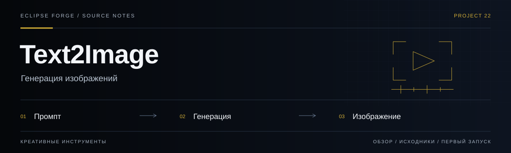
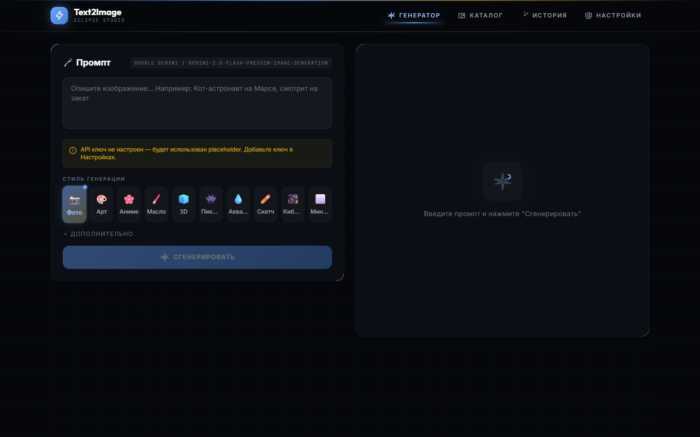
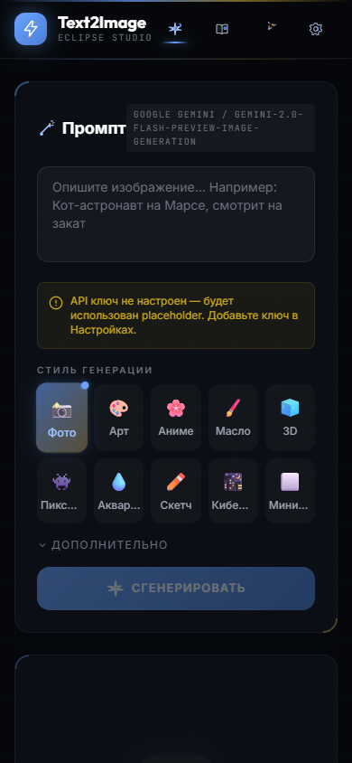

# Text2Image

<!-- project-links:start -->
[Открыть веб-версию](https://text2image-studio.pages.dev) · [Документация](docs/repository-guide.md) · [Код](https://github.com/PavelHopson/Text2Image/tree/master) · [История изменений](https://github.com/PavelHopson/Text2Image/commits/master/)
<!-- project-links:end -->



**Генерация изображений.** Интерфейс текстовой генерации изображений с несколькими AI-провайдерами и настройками результата.

<!-- eclipse-forge-projects:start -->
## Проекты Eclipse Forge

[Главная Eclipse Forge](https://eclipse-forge.ru/) · [Eclipse Library](https://library.eclipse-forge.ru/) · [Eclipse DnD Forge](https://dnd.eclipse-forge.ru/)

Исходный код: [Eclipse Forge Landing](https://github.com/PavelHopson/Eclipse-forge-website) · [Eclipse Chat](https://github.com/PavelHopson/eclipse-chat) · [Eclipse Connect](https://github.com/PavelHopson/eclipse-connect) · [Eclipse Library](https://github.com/PavelHopson/eclipse-library) · [Eclipse AI Hub](https://github.com/PavelHopson/eclipse-ai-hub) · [Eclipse Ultron / Sentinel](https://github.com/PavelHopson/eclipse-hopson-sentinel) · [Eclipse Webclaw](https://github.com/PavelHopson/Eclipse-webclaw) · [Eclipse DnD Forge](https://github.com/PavelHopson/eclipse-dnd-forge) · [Finflow](https://github.com/PavelHopson/finflow) · [Eclipse Media](https://github.com/PavelHopson/eclipse-media) · [Shotforge](https://github.com/PavelHopson/shotforge) · [Text2Image](https://github.com/PavelHopson/Text2Image) · [Educator AI](https://github.com/PavelHopson/Educator-AI) · [@pavelhopson/retry-http](https://github.com/PavelHopson/retry-http)
<!-- eclipse-forge-projects:end -->

<!-- repository-guide:start -->
[Интерфейс](#readme-interface) · [Первый запуск](#readme-start) · [Что внутри](#readme-map) · [Путеводитель](docs/repository-guide.md#start) · [Карта кода](docs/repository-guide.md#map) · [Проверки](docs/repository-guide.md#checks) · [Границы и права](docs/repository-guide.md#boundaries)

<a id="readme-interface"></a>

## Интерфейс



**Панель генератора: промпт, стили и область результата. Снято без ключа и без генерации.**

Локальный снимок от 8 сентября 2026: отдельный профиль браузера, без внешних API и пользовательских секретов. Это вид интерфейса, не подтверждение production-функций.

<details>
<summary><strong>Мобильный экран · 390 px</strong></summary>



</details>

[Открыть в полном размере](docs/assets/ui/overview.png) · [Данные снимка](docs/assets/ui/capture.json)

<a id="readme-map"></a>

## Проект за минуту

- **[Генератор](<src/pages/Generator.tsx>)** — Промпт, параметры и работа с результатом.
- **[Каталог промптов](<src/pages/PromptCatalog.tsx>)** — Повторное использование подготовленных запросов.
- **[Медиа-контракт](<src/services/mediaAssetContract.ts>)** — Структура передачи визуального артефакта.

<a id="readme-start"></a>

## Начать локально

**Среда:** Node.js и npm. **Источник:** [package.json](<package.json>).

Из корня клонированного репозитория:

```bash
npm ci
npm run dev
```

Интерфейс и внешние AI-вызовы — разные этапы. До подключения провайдера проверьте настройки, стоимость и обработку ключей; значения секретов в README не размещаются.

<details>
<summary><strong>Перед первым запуском и изменением кода</strong></summary>

- Команды сверены с исходниками 8 сентября 2026. Это инструкция, а не отметка об успешном запуске или текущем production.
- Установка зависимостей может обращаться в registry и выполнять lifecycle scripts. Используйте отдельную рабочую среду и демонстрационные данные.
- Провайдеры имеют разные условия хранения и использования данных; ключи и стоимость проверяются до запуска.
- [ROADMAP.md](<ROADMAP.md>)

</details>
<!-- repository-guide:end -->

## Что умеет

- Генерация изображения по текстовому описанию
- Улучшение промпта перед генерацией
- 10 визуальных стилей: photo, anime, watercolor, cyberpunk, pixel-art и другие
- 5 соотношений сторон
- Каталог готовых prompt templates
- История генераций с локальным сохранением в браузере
- Настройка AI-провайдера и модели без отдельного backend
- Export metadata-only `eclipse.media-asset.v1` passport for local validation in Eclipse Media

<a id="product-radar"></a>

## Источники и идеи развития

Источник: [Eclipse Library · July 2026 project integration](https://library.eclipse-forge.ru/#guide/july-2026-project-integration).

| Reference | Как использовать |
|-----------|------------------|
| **Google image/video low-cost tier** | Проверить как дешёвый provider для генерации изображений, карточек проектов, UI mockups и коротких visual loops. Перед внедрением: price/quality/watermark тест на фиксированном наборе промптов |
| **Photo restoration prompt pack** | Добавить prompt-template для восстановления старых фото: царапины, шум, пятна, мягкий upscale и естественная колоризация |
| **prompts.chat / Claude Prompt Library** | Источник prompt templates, но только после ручной фильтрации; не импортировать тысячи промптов без качества и категорий |
| **Seed-Audio 1.0** | Не core-фича Text2Image, но reference для будущих animated stories / narrated image packs. Только consent-safe voice usage |
| **Torlink** | Не интегрировать. Максимум reference для очередей загрузки открытых assets, без публичного "скачать любые файлы" сценария |

## Провайдеры

- Google Gemini
- OpenAI DALL-E / GPT Image
- OpenRouter
- Ollama

Для Ollama предусмотрен локальный режим с настраиваемым `baseUrl`.

## Структура приложения

```text
src/
  components/        UI-пикеры и навигация
  pages/
    Generator.tsx    основной экран генерации
    History.tsx      локальная история
    PromptCatalog.tsx каталог шаблонов
    Settings.tsx     провайдеры, модели, API ключи
  services/
    aiService.ts     enhancement + image generation
    mediaAssetContract.ts versioned sidecar without binary data or URLs
    historyService.ts локальное хранение истории
  types.ts           модели данных и провайдеры
```

## Быстрый старт

```bash
git clone https://github.com/PavelHopson/Text2Image.git
cd Text2Image
npm install
npm run dev
```

## Переменные окружения

По умолчанию приложение можно использовать через экран `Settings`, сохраняя ключ локально в браузере.

Если нужен дефолтный ключ для локального запуска, создайте `.env` на основе `.env.example`:

```bash
cp .env.example .env
```

```env
GEMINI_API_KEY=your_api_key_here
```

## Проверка качества

```bash
npm run typecheck
npm run build
```

## Demo

[text2image-studio.pages.dev](https://text2image-studio.pages.dev)
<a id="eclipse-forge-visual-contract"></a>

## Визуальный стандарт Eclipse Forge

Text2Image uses the local `eclipse-forge.visual-system.v1` snapshot in the `product` profile: self-hosted Outfit/Inter/JetBrains Mono typography, signal-blue actions, warm-gold accents, grid/grain depth and reduced-motion-safe transitions. The token/font snapshot is served by this application and does not depend on the Landing or Google Fonts at runtime. Font provenance, hashes and OFL notices are stored in `public/fonts`.

Историческая проверка визуального пилота от 12 августа 2026: TypeScript и production-сборка. Тогда также обновлён совместимый lockfile для устранения замечаний аудита production-зависимостей.
